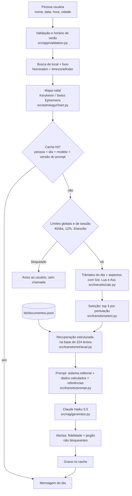

# Mensagem Astral

Aplicação web que gera uma **mensagem diária curta em português do Brasil** a partir do mapa natal da pessoa e dos
trânsitos planetários do dia. O cálculo astrológico é determinístico (Swiss Ephemeris via Kerykeion), o conhecimento vem
de uma base própria de 224 textos recuperada por **metadados (RAG estruturado, sem embeddings)** e o texto final é
escrito pelo **Claude Haiku 5.5**, com checagens automáticas, cache e limites de gasto.

**MVP publicado: <https://mensagem-astral.streamlit.app/>** (Streamlit Community Cloud, sem login).
Se o app estiver em repouso, a primeira abertura leva alguns segundos.

> Projeto de entretenimento e portfólio. As interpretações astrológicas são simbólicas e não têm comprovação científica;
> o aviso completo está na interface (expander "Privacidade e termos de uso"), nunca no corpo da mensagem.

## O que faz
1. A pessoa informa nome (opcional), data, hora e cidade de nascimento.
2. O app resolve o local e o fuso (inclui horário de verão histórico), calcula o mapa natal e os trânsitos do dia.
3. Seleciona os trânsitos mais relevantes, recupera os textos da base que os explicam e monta o prompt.
4. O Claude Haiku 5.5 escreve **70 a 100 palavras, em até 2 parágrafos**, sobre uma situação cotidiana e uma sugestão
   prática, sem citar planetas, signos nem aspectos (a astrologia é só o raciocínio interno).
5. A mensagem fica em cache por pessoa, dia e versão do prompt: consultar de novo não chama a API.

Principais funcionalidades: validação de entrada em português (data futura, horário inexistente ou ambíguo no horário de
verão, cidade homônima), interface mobile-first com identidade visual própria, limites de uso globais e por sessão,
chave de emergência para pausar a geração, e política de privacidade (o nome, a data, a hora e o local **não** vão ao
modelo).

## Stack e por que cada escolha
| Camada | Tecnologia | Motivo (o que o código e a documentação sustentam) |
|---|---|---|
| Cálculo astrológico | Kerykeion 6 (Swiss Ephemeris), zodíaco tropical, casas Placidus | Efemérides precisas e determinísticas; o LLM nunca calcula posições |
| Local e fuso | geopy/Nominatim, timezonefinder, `zoneinfo` | Serviço gratuito; o fuso IANA traz o horário de verão histórico |
| Base de conhecimento | JSONL com JSON Schema (v2.0) e validador próprio | Textos próprios, versionados, validados (hash, IDs, cobertura) |
| Recuperação | Consulta por entidades (`KnowledgeBase.lookup`) | Ver "RAG estruturado" abaixo |
| LLM | Claude Haiku 5.5 (`claude-haiku-5-5`) via SDK `anthropic` | Escolhido pelo menor custo (motivo registrado no commit que o definiu); troca por parâmetro |
| Interface | Streamlit 1.67, CSS e SVG próprios | Entrega rápida de um MVP em Python puro |
| Hospedagem | Streamlit Community Cloud | Gratuita; ver trade-offs em [`docs/decisoes-tecnicas.md`](docs/decisoes-tecnicas.md) |
| Testes | pytest e `streamlit.testing.v1.AppTest`; verificação visual com capturas do Chrome (Playwright), fora do repositório | Sem rede e sem chamadas pagas nos testes automatizados |

## Arquitetura


## Fluxo completo
1. **Dados de nascimento → mapa.** `calculate_chart` converte o horário local para UTC pelo fuso IANA e devolve um dict
   JSON com 10 planetas, Ascendente, Meio do Céu, 12 casas e aspectos.
2. **Trânsitos.** `transit_positions` calcula as posições do dia (meio-dia no fuso do local de nascimento) e
   `find_aspects` mede conjunção, sextil, quadratura, trígono e oposição com Sol, Lua e Ascendente natais.
3. **Seleção.** `pontuação = peso do aspecto × peso do planeta × peso do ponto natal × fator de orbe`; ficam os 3 maiores
   (mínimo 0,15). Trânsitos que já foram destaque nos 2 dias anteriores têm a nota multiplicada por 0,6 (variedade).
4. **Recuperação.** Para cada trânsito: significado do planeta, planeta no signo de hoje, aspecto e ponto natal no signo
   natal; mais a Lua do dia. Nenhum documento é criado: o que faltar na base interrompe a geração.
5. **Prompt.** Prompt de sistema com regras editoriais + dados calculados + textos de referência + mensagens recentes
   (para não repetir). Versão atual: `daily-6`.
6. **Geração.** Uma chamada ao Haiku 5.5 (`effort: low`, `max_tokens` 4000), com timeout de 60 s e 2 novas tentativas.
7. **Checagens.** `check_faithfulness` avisa se a mensagem cita signo, planeta, aspecto ou casa que não foi calculado nem
   recuperado; `check_no_jargon` avisa se algum termo astrológico escapou para o texto. São alertas, não bloqueios.
8. **Cache.** `<pessoa>/<AAAA-MM-DD>.<versão-do-prompt>.json`, escrita atômica; a pessoa é um hash (HMAC com sal secreto
   quando configurado) do instante UTC e das coordenadas, sem dados de nascimento em claro.

## RAG estruturado (por que não há embeddings nem banco vetorial)
A base tem 224 documentos organizados por entidade astrológica (`signo`, `planeta`, `casa`, `aspecto`, `elemento`,
`planeta_signo`, `elemento_signo`), cada um com ID previsível (`planeta_signo.moon.gemini`). O mapa calculado já diz
exatamente **quais entidades interessam**, então a recuperação é uma consulta exata por metadados
(`kb.lookup(planeta="moon", signo="Gêmeos")`), não uma busca por similaridade.

O que o código sustenta:
- **Determinismo e cobertura verificável:** há testes que conferem que todo signo × casa possível recupera documentos sem lacunas e que a base cobre
  10 planetas × 12 signos e 5 pontos × 12 signos; com embeddings isso seria uma propriedade probabilística.
- **Fidelidade checável:** como se sabe quais documentos entraram, `check_faithfulness` consegue avisar quando a mensagem
  cita algo fora do que foi calculado ou recuperado.
- **Sem infraestrutura extra:** nada a hospedar, indexar ou reindexar; funciona em disco efêmero.
- A base **está preparada** para embeddings (`KnowledgeBase.rag_records()` gera texto indexável e metadados), mas isso
  **não é usado** hoje. O registro histórico do projeto planejava avaliar `sentence-transformers` com FAISS/Chroma; a
  decisão por metadados foi tomada na Etapa 4 sem um documento próprio de justificativa. Detalhes em
  [`docs/decisoes-tecnicas.md`](docs/decisoes-tecnicas.md).

Limite honesto: como não há texto de "trânsito" na base, a mensagem combina blocos gerais (planeta, signo, aspecto, ponto
natal). Perguntas livres do tipo "chatbot" não são suportadas, pois a recuperação depende de entidades do mapa.

## Estrutura do repositório
```
app/                    interface Streamlit (streamlit_app.py, ui/ tema CSS, SVGs e textos legais, static/ fontes)
src/astrology/          motor astrológico (mapa natal)
src/transits/           trânsitos, seleção, recuperação, prompt diário, cache, pipeline
src/rag/                recuperação do mapa natal, prompt natal, AnthropicLLM, checagem de fidelidade
src/data/               KnowledgeBase, validador e JSON Schemas
src/app/                serviço, validação, busca de local e limitador de uso (sem dependência do Streamlit)
kb/                     documentos.jsonl (224 textos), README e nota de origem
tests/                  437 testes automatizados
notebooks/              execução no Colab das etapas 1 a 5 (sem outputs)
docs/                   documentação técnica (ver abaixo)
```
`src/evaluation/` e `src/models/` são pacotes vazios, reservados para avaliação e fine-tuning (não implementados).

## Executar localmente
Requer Python 3.13 (versão em que foi validado).
```bash
git clone https://github.com/camilabraga-ai/Mensagem-Astral.git && cd Mensagem-Astral
python3 -m venv .venv && source .venv/bin/activate
pip install -r app/requirements.txt pytest                 # app + testes
python -m pytest -q                                        # 437 testes, sem rede e sem custo
export ANTHROPIC_API_KEY="sk-ant-..."                      # opcional; sem a chave a geração fica desativada
streamlit run app/streamlit_app.py                         # http://localhost:8501
```
Em vez da variável de ambiente, use `.streamlit/secrets.toml` (já ignorado pelo git) com `ANTHROPIC_API_KEY = "..."`.
A busca de cidade usa o Nominatim e precisa de internet. Configurações opcionais (ambiente ou Secrets):
`CACHE_SALT`, `MAX_DAILY_GENERATIONS`, `MAX_HOURLY_GENERATIONS`, `GENERATION_ENABLED`.
Para ver o visual sem API: `MENSAGEM_ASTRAL_PREVIEW=result streamlit run app/streamlit_app.py`.

## Testes e validações
**437 testes passam** (última execução em 2026-11-17, ~11 s), todos offline e com LLM simulado: motor astrológico,
base de conhecimento, recuperação, trânsitos, prompts, cache, limites de uso, validação de formulário, interface de
ponta a ponta (`AppTest`), layout e configuração de publicação (inclui varredura de segredos).
Estratégia, o que foi medido e o que **não** foi avaliado: [`docs/avaliacao.md`](docs/avaliacao.md).

## Métricas disponíveis
Medidas com a API real e guardadas apenas no cache local (amostras pequenas, não são benchmark):

| Item | Valor | Fonte |
|---|---|---|
| Tokens por mensagem diária (`daily-6`, 3 amostras) | entrada 3.611–6.293, saída 906–1.727 (a saída inclui raciocínio interno do modelo) | cache local |
| Tamanho das mensagens `daily-6` | 83, 85 e 92 palavras (meta: 70–100) | cache local |
| Alertas de fidelidade/jargão nas 9 mensagens guardadas | 0 | cache local |
| Custo por mensagem | ≈ US$ 0,001 (estimativa a partir dos tokens e de um preço **assumido**) | `docs/avaliacao.md` |
| Latência | **não medida** | pendência |

## Segurança, privacidade e limitações
- **Chave da Anthropic** só no servidor (variável de ambiente ou Secrets); nunca no repositório, no navegador ou nos logs.
  Um teste varre o repositório atrás de padrões de chaves e tokens.
- **Privacidade:** o prompt enviado ao modelo contém só signos, graus e textos da base (teste garante que nome, data,
  hora e local não vão). Data, hora e cidade vão ao Nominatim para achar o local. O cache guarda a mensagem sob um hash.
  Texto de privacidade e termos em `app/ui/legal.py`; rascunho, ainda sem revisão jurídica.
- **Custos:** cache, 3 mensagens por sessão, 40 por dia e 12 por hora no servidor, chave de emergência e limite de
  gastos no console da Anthropic (a proteção final).
- **Limitações conhecidas:** cache e contador de uso são locais e se perdem quando a hospedagem reinicia; app público
  sem login compartilha a cota diária entre todos; Nominatim gratuito tem limite de uso; só Sol, Lua e Ascendente natais
  entram nos trânsitos; a checagem de fidelidade é por palavras, não semântica; qualidade textual avaliada por leitura
  manual, sem métrica automática; Safari não testado.

## Possíveis evoluções
Avaliação automática da qualidade (LLM-as-judge e/ou rubrica) e medição de latência; persistência de cache e contador
(Supabase, Redis ou Sheets); mais pontos natais e textos de trânsito na base; embeddings como alternativa **comparada**
com a recuperação atual; fine-tuning LoRA somente se uma avaliação mostrar ganho (ver `docs/decisoes-tecnicas.md`);
trocar o geocodificador por um serviço com garantia de uso.

## Documentação
| Documento | Conteúdo |
|---|---|
| [`docs/avaliacao.md`](docs/avaliacao.md) | Testes, validações, métricas medidas × estimadas × pendentes |
| [`docs/decisoes-tecnicas.md`](docs/decisoes-tecnicas.md) | Decisões de engenharia e trade-offs |
| [`docs/rag.md`](docs/rag.md) | RAG do mapa natal e resultados do primeiro teste real |
| [`docs/transitos.md`](docs/transitos.md) | Trânsitos, seleção, cache e custo |
| [`docs/app.md`](docs/app.md) | Interface, controle de custos e segurança |
| [`docs/publicacao.md`](docs/publicacao.md) | Publicação no Streamlit Cloud e manutenção |
| [`docs/privacidade.md`](docs/privacidade.md) | Mapa de dados pessoais |
| [`docs/etapa5_progresso.md`](docs/etapa5_progresso.md), [`etapa6`](docs/etapa6_progresso.md), [`etapa7`](docs/etapa7_progresso.md) | Histórico por etapa |
| [`kb/README.md`](kb/README.md), [`kb/ORIGEM.md`](kb/ORIGEM.md) | Formato e origem da base de conhecimento |

## Roteiro do projeto
- [x] Etapas 1 a 7: configuração, motor astrológico, base de conhecimento, RAG, trânsitos e mensagem diária, interface web, publicação do MVP
- [x] Avaliação e documentação final (esta revisão)
- [ ] Fine-tuning (LoRA): adiado; não implementado

## Dados
Nenhum livro protegido, credencial ou modelo grande é versionado. Ver `data/README.md`.
